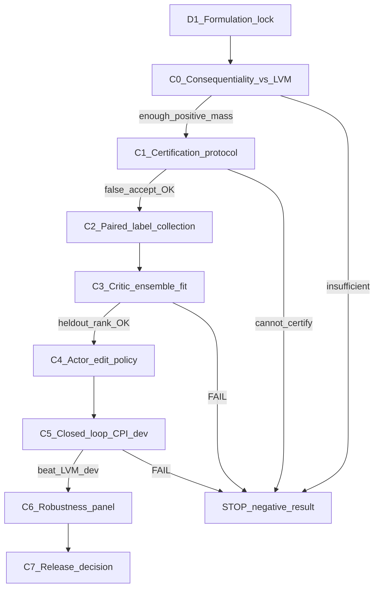

# CPI-SPARC — Independent Evaluation and Win Roadmap

**Date:** 2026-10-19  
**Status:** Opinion + roadmap. Not an implementation authorization.  
**Superseding synthesis:** `SPARC_CPI_VS_ROLLOUT_PI_OPINION.md` — commit to **LVM-RPI-Distill** (rollout-PI teachers + CPI-style deploy gate), not two forks.  
**Inputs:** `SPARC_RESEARCH_DIAGNOSIS_AND_OBJECTIVE.md`; POPL robustness / execution audit; RAO / W / pack-defect FAIL history; CPI and LVM-rollout proposals.

---

## 1. Independent opinion (not face value)

### Verdict on the idea

**CPI-SPARC (LVM-anchored certified selective deviation) is the strongest *design candidate* we have proposed**, and it is directionally aligned with the diagnosis and the success/fail map.

It is **not** yet a validated solution, and it is **not** ready to implement as a full training stack.

### What is genuinely right

1. **Right anchor.** LVM is the strongest observed baseline (~46.82 nominal). Anchoring to Direct or VLRO answers the wrong question. VLRO (~39.98) stays as an *eval* baseline only.

2. **Right empirical pattern.** POPL ≈ LVM on 3/4 locked val seeds and +~1.57 on 82002 (~0.84% mean). That is exactly “strong almost everywhere, wrong in sparse states” — selective deviation, not free-running PPO.

3. **Right label structure.**  
   \(\Delta G = G(A\rightarrow\pi_{\mathrm{LVM}}) - G(A_{\mathrm{LVM}}\rightarrow\pi_{\mathrm{LVM}})\)  
   isolates *one* deviation then returns to LVM. Cleaner than Direct↔POPL policy selection, RHO surrogates, or free-running POPL returns.

4. **Right failure-mode table.** Mandatory LVM fallback addresses “worse than LVM after training”; pack-level candidates address companion/collateral effects; realized \(\Delta G\) addresses surrogate failure.

5. **Right scientific framing.** Success = beat LVM on \(J\) with safety/runtime; LVM as floor in the *accepted* action set — not “hope we beat LVM after the run.”

### What is overclaimed or fragile

1. **The “guarantee” is conditional on a valid lower bound.**  
   \(V^{\pi_{\mathrm{CPI}}}\ge V^{\pi_B}\) holds **if** \(\underline A_B(s,A)\le A_B(s,A)\) for every accepted deviation.  
   Ensemble \(\mu-\beta\sigma-c_{\mathrm{cal}}\) is a **heuristic**, not a proof.  
   - False positives (certify when true \(\Delta G\le 0\)) → can lose to LVM (destroys the floor).  
   - Over-conservatism → always-LVM (JIPI KEEP reincarnated; no win).  
   **Certification validity is the product**, not a footnote.

2. **Headroom evidence is thin and val-contaminated.**  
   ~0.84% POPL−LVM on four repeatedly examined seeds shows LVM is not globally optimal; it does **not** establish frequency, magnitude, or 15%. Using 8200x as design proof without a fresh split repeats the overfitting cycle.

3. **RAO is a warning, not a proof CPI fails.**  
   RAO targeted “which of two frozen policies wins” with a logistic selector and G4 FAIL. CPI targets “LVM-relative advantage of *this pack*” with LVM continuation. Different — but the failure mode “score says up, realized doesn’t” can recur if \(\underline A\) is bad.

4. **Paired collection cost and hygiene remain hard.** Same-state forks, common randomness, force_match / G=0 pathologies already hurt RAO. CPI needs that machinery to work *well*, not aspirationally.

5. **Runtime budget is non-trivial.** LVM + actor + \(K\) packs + \(M\) critics in ≤10 ms needs a hard latency gate; dual-propose already stressed the budget.

6. **Actor loss \(\mathbb{E}[\max(0,\underline A)]\) does not by itself find rare gems.** If positive mass is tiny, training can starve; exploration of pack edits must be deliberate (edit operators around \(A_B\)), not hope autoregressive sampling finds them.

### Bottom line opinion

| Claim | Assessment |
|---|---|
| CPI is the right *class* of controller given evidence | **Agree** |
| Math guarantees we won’t lose to LVM in practice | **Disagree until certification calibrated** |
| Existing POPL−LVM gap justifies expecting large / 15% wins | **Disagree** — only “some room” |
| Implement full CPI training now | **Disagree** — consequentiality + cert design first |
| Skip formulation / jump to another free PPO | **Disagree** |

**Decision:** Adopt CPI-SPARC as the **leading candidate architecture** for the win path. **Do not** authorize end-to-end training until Phase C0–C1 below pass. Do not invent a parallel free-running scheduler.

---

## 2. What “win” means (locked)

\[
\begin{aligned}
&J_{\mathrm{CPI}} > J_{\mathrm{LVM}} &&\text{fair matched compare (primary)},\\
&P_{\mathrm{viol}}\le 0.02,\\
&T_{\mathrm{decision}}\le 10\,\mathrm{ms},\\
&\text{accepted deviations satisfy certified }\underline A_B>0.
\end{aligned}
\]

- Ties / few defensible losses on secondary conditions OK (user success definition).
- ~15% is stretch, not a gate.
- Eval baselines: LVM, VLRO, Direct, frozen others — **anchor remains LVM**.
- Hard stop: if C0 shows insufficient LVM-relative headroom, or C1 certification cannot achieve low false-accept rate, conclude RL selective improvement unsupported — do not move baseline/metric.

---

## 3. Complete roadmap for the win

Phases are sequential. Finishing \(k\) does not start \(k+1\). Each requires explicit user authorize. No routers, no decode hacks on frozen POPL, no fitting on locked val `82001/02/11/12`, final-test sealed until a separate release decision.

### Phase D1 — Formulation lock (document only)

**Goal:** One coherent write-up of CPI-SPARC as the method that follows from the diagnosis (not a new speculative algo name).

**Deliverable:** `SPARC_FORMULATION_LOCK.md` containing:

- Research question (joint radio/computation scheduling for realized \(V_{\mathrm{done}}\)).
- Controlled variables / dynamics / constraints (existing interface).
- Objective \(J\); success vs LVM.
- CPI math: \(A_B\), \(\underline A_B\), \(\pi_{\mathrm{CPI}}\), label \(\Delta G\), LVM continuation.
- Explicit non-claims (no guarantee of 15%; guarantee only under valid lower bound).

**Pass:** User accepts doc.  
**Forbid:** MATLAB, training, code beyond stubs.

---

### Phase C0 — Consequentiality vs LVM (training-free / minimal collection)

**Goal:** Answer: *Is there enough controllable LVM-relative headroom to bother?*

**Protocol (must be predeclared before seeing results):**

- Fresh train/dev sim seeds (e.g. continue `721xx` / new block — **not** 8200x for fitting or threshold choice).
- At opportunity epochs: \(A_B=\mathrm{LVM}(s)\); generate a **small fixed** set of pack edits (omit one / add one / rebind one / swap companion) under \(\mathcal F\) + governor — can be heuristic editors first, not a trained actor.
- For each edit, collect paired \(\Delta G\) with LVM continuation + common randomness.
- Report: frac(\(\Delta G>0\)), frac(\(\Delta G>\varepsilon\)), mean \(\Delta G_+\), mean \(\Delta G\), regime breakdown (align with success/fail map hypotheses).

**Pass (example bar — lock numbers in auth):**  
e.g. on held-out dev forks: \(\mathbb{E}[\max(\Delta G,0)] \ge \delta\) and \(\Pr(\Delta G>\varepsilon)\ge p\) with predeclared \(\delta,\varepsilon,p\).

**Fail → STOP:** LVM-relative room too sparse/small; document negative result. Do not build CPI.

**Note:** Existing POPL−LVM +1.57 on one val seed is **motivation only**, not a C0 pass.

---

### Phase C1 — Certification protocol (before trusting the floor)

**Goal:** Define and validate how \(\underline A_B\) may accept a deviation.

**Deliverable:**

- Ensemble + calibration rule fixed on fit only.
- Held-out metrics:  
  - **False accept rate:** \(\Pr(\underline A_B>0 \mid \Delta G\le 0)\) — must be ≤ predeclared \(\alpha\).  
  - **Capture rate:** \(\Pr(\underline A_B>0 \mid \Delta G>\varepsilon)\).  
  - Calibration plot of \(\underline A\) vs realized \(\Delta G\).

**Pass:** False accept ≤ \(\alpha\) and capture high enough that expected certified gain \(>0\) on held-out.  
**Fail → STOP or redesign cert only** — do not loosen by switching anchor to VLRO.

---

### Phase C2 — Paired label collection (budgeted)

**Goal:** Dataset of \((s, A_B, A, \Delta G)\) for critic/actor under C0/C1 protocol at scale.

**Rules:** Train/dev seeds only; common random numbers; LVM continuation both branches; log force_match / feasibility; stop at predeclared \(N\) pairs.

**Pass:** Dataset complete + hygiene report (match rate, \(\Delta G\) histogram).

---

### Phase C3 — Advantage critic ensemble

**Goal:** Fit \(\hat A_{\phi_m}(s,A,A_B)\approx\Delta G\); freeze calibration \(c_{\mathrm{cal}},\beta\).

**Pass:** Held-out Spearman / ranking of packs by \(\Delta G\) beats constant baselines by predeclared margin; C1 false-accept still holds with frozen calib.  
**Fail → STOP.**

---

### Phase C4 — Edit actor (optional until C3 passes)

**Goal:** \(\pi_\theta(\cdot\mid s,A_B)\) proposes \(K\) complete feasible packs (masked AR + STOP), biased to edits around \(A_B\).

**Train:** Maximize certified improvement \(\mathbb{E}[\max(0,\underline A_B)]\) using **frozen** critics for the gate; do not let actor bypass certification at deploy.

**Pass:** On held-out states, actor proposals increase rate of true \(\Delta G>0\) among candidates vs heuristic editors alone (predeclared).

---

### Phase C5 — Closed-loop CPI on development seeds

**Goal:** Deploy \(\pi_{\mathrm{CPI}}\) (runtime steps 1–6) on held-out **dev** seeds (not locked val for fitting).

**Pass:**  
- Mean \(V_{\mathrm{done}} > V_{\mathrm{LVM}}\) (point estimate; report CI).  
- \(P_{\mathrm{viol}}\le 0.02\).  
- Decision latency P95/max ≤ 10 ms after warmup.  
- Fraction of epochs accepting deviation reported; accept rate should be sparse if theory matches map.

**Fail → STOP** (or one predeclared cert tightening — not architecture shopping).

---

### Phase C6 — Robustness panel (training-free eval)

**Goal:** Same condition axes as POPL robustness; CPI vs LVM/Direct/VLRO/POPL frozen.

**Pass:** Win vs LVM on aggregate with allowed ties / few defensible losses (predeclare which losses are acceptable, e.g. helper_homog if equal to LVM).  
**Primary:** still beat LVM overall; do not declare win from beating VLRO.

---

### Phase C7 — Release decision

Only if C5+C6 pass: separate authorize to touch sealed final-test. Manuscript claims limited to what C5–C6 support.

---

## 4. Mapping roadmap → prior failures

| Prior failure | Where roadmap blocks recurrence |
|---|---|
| Free PPO worse than LVM | Deploy gate: only \(\underline A_B>0\); else \(A_B\) |
| JIPI KEEP≈100% | C0/C1 must show positive mass + non-zero capture; else STOP honestly |
| RHO surrogate | Labels = realized \(\Delta G\) only |
| POPL poor generalization | Uncertified states stay LVM |
| RAO policy ID | Target is pack advantage vs LVM, not policy class |
| Decode omit/helper hacks | No decode “fix” of frozen POPL; edits are candidates scored by \(\Delta G\) |
| Val overfitting | C0–C5 fit on train/dev; 8200x eval-only after freeze |
| 15% fantasy | Stretch only; C0 sets honest expectation |

---

## 5. Immediate next action (recommended)

1. **Authorize Phase D1** — write `SPARC_FORMULATION_LOCK.md` (CPI as the method; no code/MATLAB).  
2. **Then authorize Phase C0** — consequentiality-vs-LVM protocol with numeric pass bars **before** collection.  
3. Implement nothing of the actor/ensemble until C0 passes.

If the user wants a single phrase:

`AUTHORIZE Phase D1 — CPI formulation lock`

---

## 6. Honest expectation

- **Supported now:** LVM is improvable in some states; whole-pack downstream interaction is the right error class; CPI is the right *shape* of controller.  
- **Not supported now:** that certified deviations are frequent/large enough for a large mean gain, or that \(\underline A\) can be made safe enough to preserve the LVM floor.  
- **Win path:** prove headroom (C0) → prove certification (C1) → then learn. Anything else repeats the project’s central failure mode.
